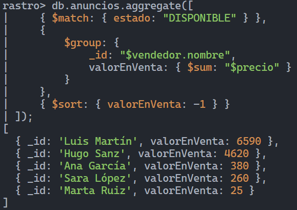

# Rastro · MongoDB

Diseño de una base de datos para una app de compraventa de segunda mano en la Comunitat Valenciana. La práctica recorre el modelado de documentos, índices, consultas, agregaciones y modificaciones con `mongosh`.

## Archivos

| Archivo | Contenido |
| --- | --- |
| [rastro.js](rastro.js) | Datos y comandos de la Parte B, organizados por ejercicio. Incluye los retos opcionales. |
| [respuestas.md](respuestas.md) | Decisiones de diseño, predicciones, resultados y explicaciones. |
| [b6-4-valor-en-venta.png](b6-4-valor-en-venta.png) | Resultado de la agregación del valor en venta por vendedor. |

## Modelo

Rastro usa cuatro colecciones: `usuarios`, `anuncios`, `ofertas` y `valoraciones`. Las fotos y los atributos propios de cada categoría van dentro del anuncio; las ofertas y valoraciones tienen colecciones propias porque se consultan por separado y pueden crecer.

## Cómo revisar el script

Abre `mongosh` y ejecuta los bloques de `rastro.js` en orden. El archivo se usa por partes: B4 contiene errores intencionados para comprobar qué reglas protege MongoDB. Si los datos ya están cargados, no repitas las inserciones de B1 y B2.

## Captura de B6.4

